# ComfyUI-fidelity-3D

**Use generative AI on a luxury product without losing the product — and prove it with numbers.**

A 3D render is used as the *ground truth*. Generative AI (Flux, Qwen Image Edit, Wan 2.2 VACE in ComfyUI) creates the set, the light and the motion. Python tools measure, zone by zone, how far the product drifted, restore its texture and colour, and measure what cannot be restored (shape).

> **Disclaimer.** Personal, non-commercial test project, **not affiliated with, endorsed by or connected to** the fashion house whose bag design inspired the 3D model used here. The 3D model "Lady D-Lite" is by **Roberto Domínguez** (CC-BY), the HDRI "Studio Small 09" by **Sergej Majboroda / Poly Haven** (CC0). Any trademark visible in the renders belongs to its owner.

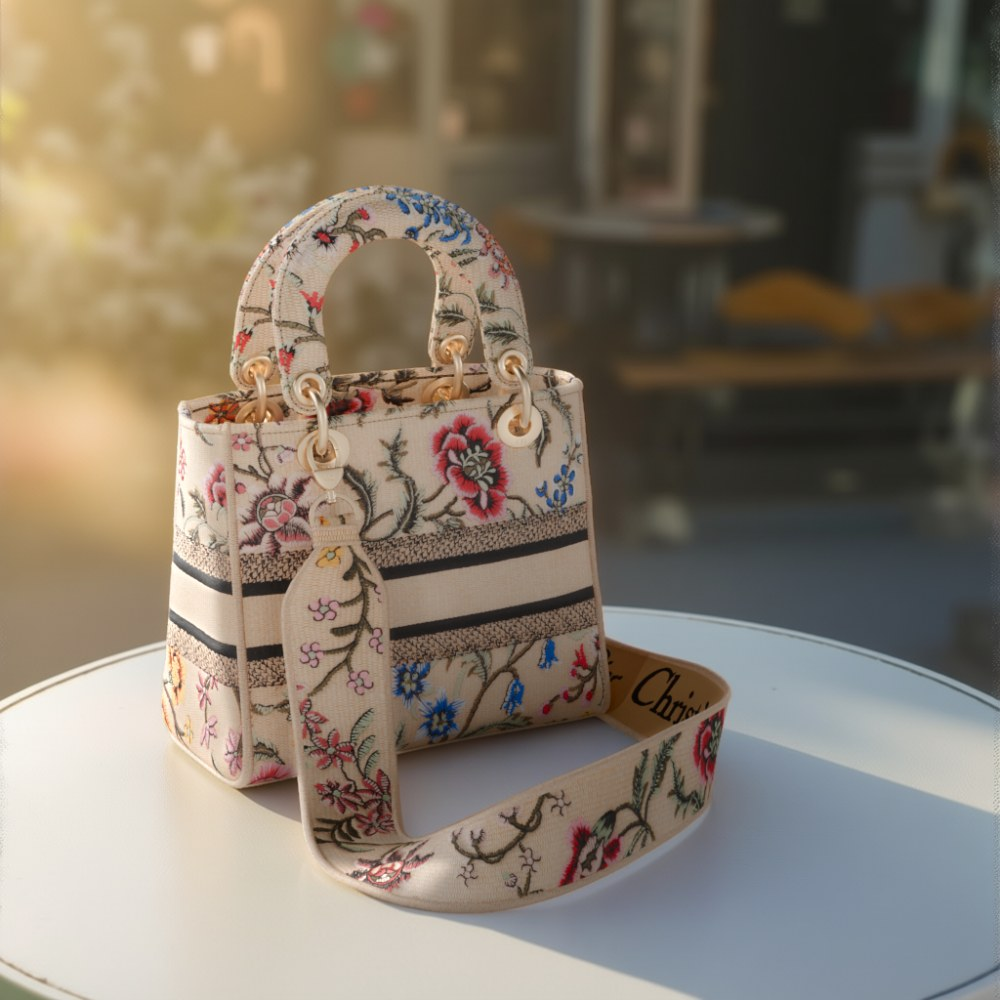

---

## Why

Generative AI makes beautiful images, but it **quietly changes the product**: embroidery is re-invented, colours drift, hardware melts. To the eye the result often looks intact. For a luxury house, a thread or a shade that moved is a refused image.

| | Structure (SSIM) | Colour (ΔE2000) |
|---|---|---|
| AI harmonized output | **0.72** ❌ | **6.4** ❌ |
| After frequency re-injection + colour restore | **0.92** ✅ | **1.3** ✅ |

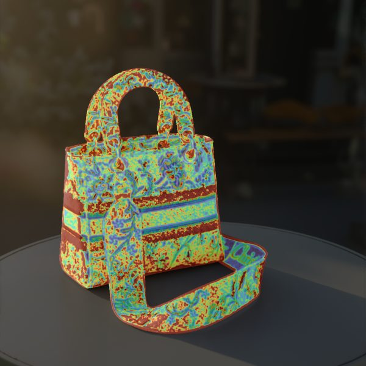

*Blue = preserved, red = changed. Flowers and lettering survive; the raffia weave was re-invented and the hue drifted — invisible at a glance, obvious in the measurement.*

---

## The method

```
 Blender (3D = truth)            ComfyUI (AI = creative)                 Python (script = the boundary)
 ─────────────────────           ───────────────────────────             ─────────────────────────────
 beauty RGBA (product)  ──┐      1. Set: Flux.1 dev + ControlNet depth   4. Frequency re-injection:
 depth (with table)     ──┼────► 2. Composite: beauty over set      ┌──►    AI light + 3D texture & colour
 masks per material     ──┐ │    3. Harmonize: Qwen Image Edit 2511 ─┘    5. Fidelity QA per zone
                          │ └──────────────────────────────────────────►    (SSIM, edges F1, ΔE2000)
                          └────────────────────────────────────────────►
```

1. **3D is the source of truth.** The exact product, plus everything the AI cannot do alone: depth, per-material masks, and a pixel-aligned reference to measure against.
2. **AI does the creative part.** Set, light, atmosphere, motion.
3. **Scripts hold the line.** Deterministic, reproducible steps: restore the product, then measure it.

### Demo A — still image

| Step | Image |
|---|---|
| 3D render (reference) | 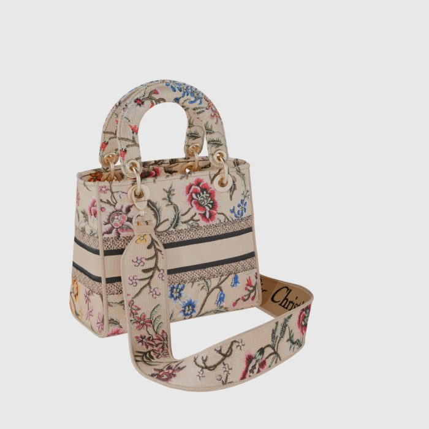 |
| Depth with an invisible round table (disparity-encoded) — without it the bag floats | 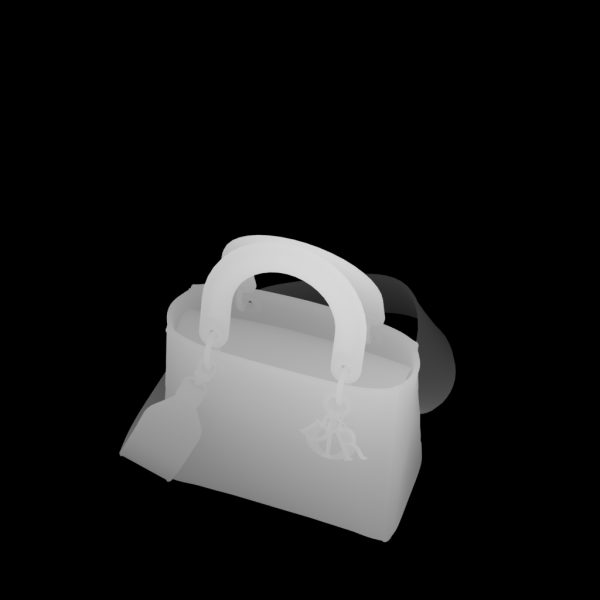 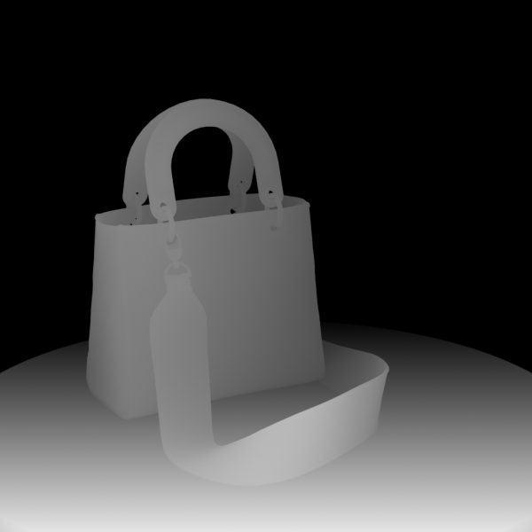 |
| Flux + ControlNet depth: set generated *around* the bag's exact silhouette | 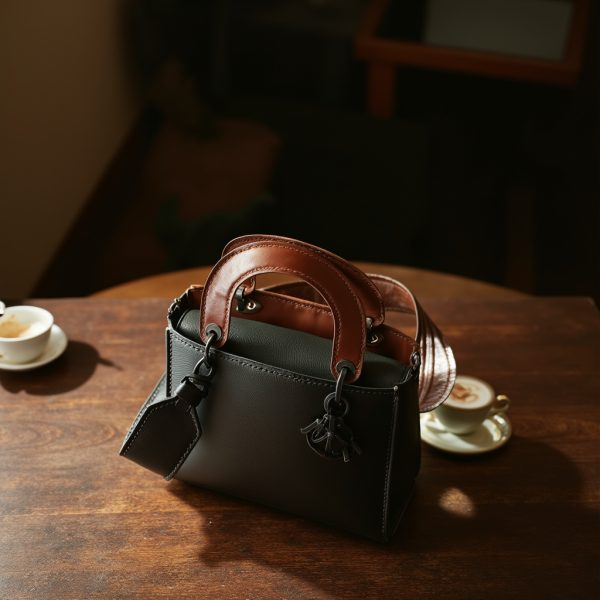 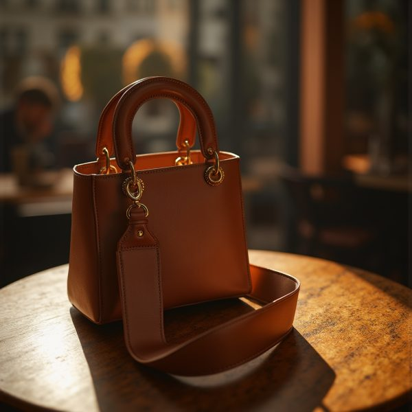 |
| Composite (looks pasted: studio light on a sunset set) | 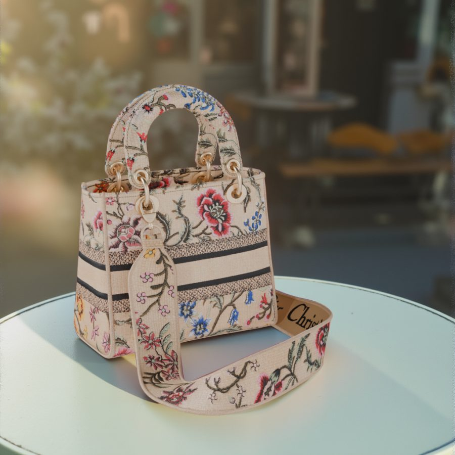 |
| Harmonized by Qwen Image Edit 2511 (Lightning 4 steps / 4 steps / 20 steps) | 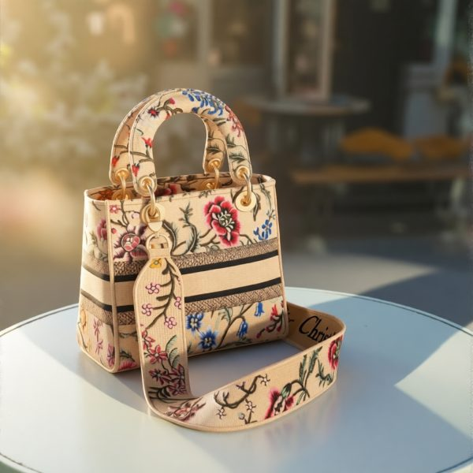 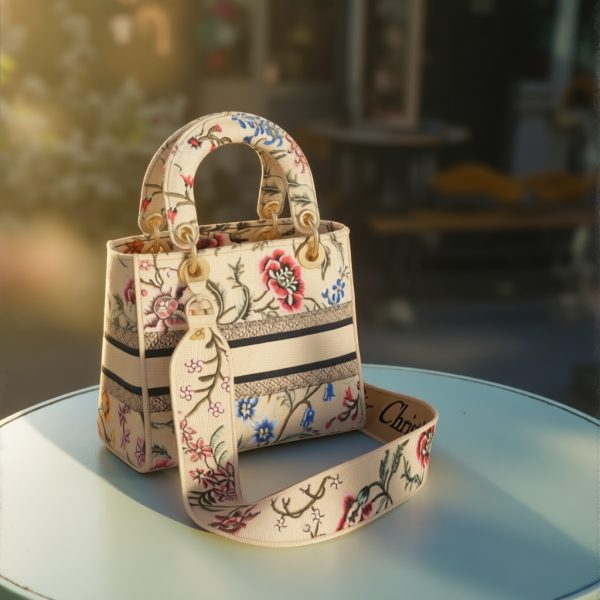 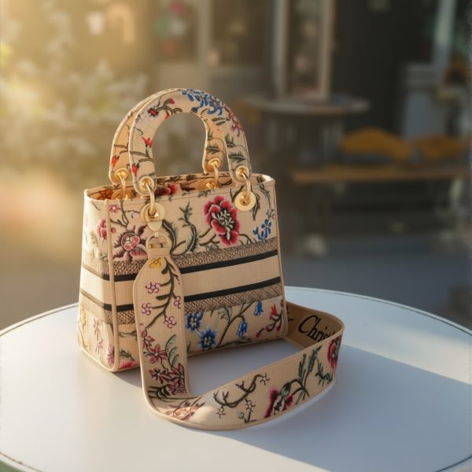 |
| Detail ×2: composite · AI harmonized · restored | 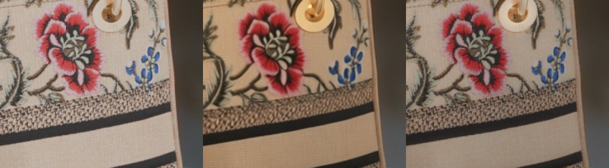 |

### Demo C — video (work in progress)

**When the AI invents the motion, the product drifts.** Wan 2.2 image-to-video with a "static camera" prompt still slid the bag by up to 15 px in 3 s, with parallax (no 2D re-alignment can fix it), and flickered every 4 frames — the period of Wan's video VAE.

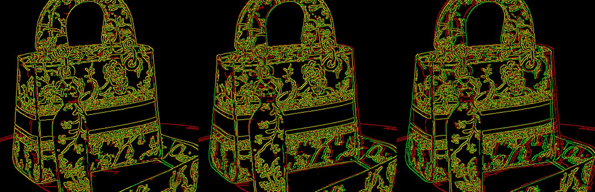

**So 3D dictates the motion, and the AI follows.** A Blender animation (the bag drops on a table and changes colour at contact) provides per-frame depth, masks and references. Wan 2.2 Fun VACE is guided by the animated depth: shape and motion follow the 3D by construction, no tracking needed.

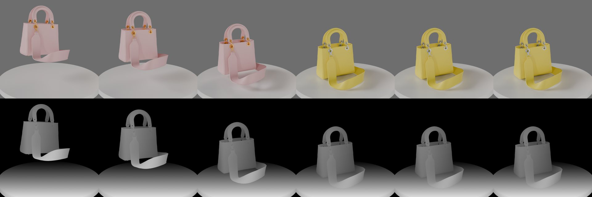
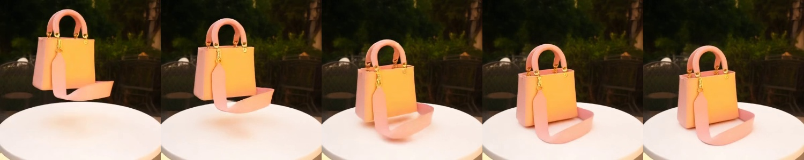

**A colour transition animated by the AI, at the moment set by 3D.** Pass 1 renders a blush-pink bag. Pass 2 is a VACE inpainting with a mask that only exists *after* contact, plus a lemon-yellow reference image rendered from 3D: the AI repaints the bag over ~10 frames. A script then keeps the AI's per-pixel transition timing but enforces the exact brand colours (leather ΔE 8.3 → 1.3).

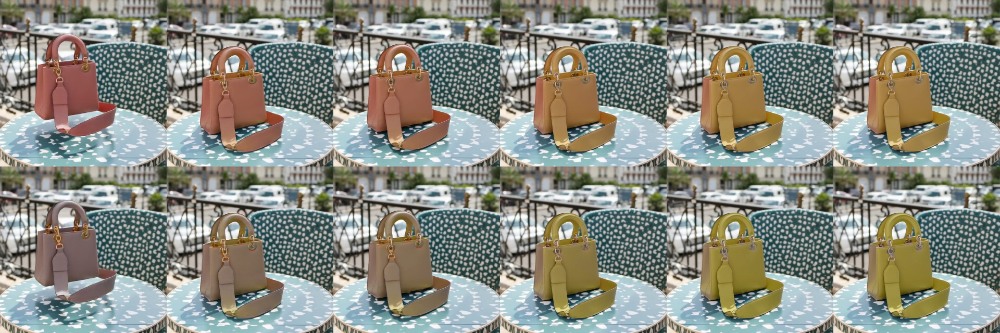

*Top: AI output (salmon pink, mustard yellow). Bottom: brand colours restored, same animated transition. Metal hardware is not solved yet (ΔE 8.6).*

### Measuring the deformation

Colour can be fixed afterwards. **Shape is harder**: is the strap 3 px wider than the real one, is a handle swelling? Because Blender drives the video, every frame has an **exact 3D reference of the same pose, seen by the same camera**. No pose estimation needed: any shape difference is a deformation invented by the AI.

**In short:**

| | Result |
|---|---|
| Measure the deformation, edge by edge, separated from lighting effects | ✅ steps 1–2 |
| Prevent it: exact mask for the repaint pass | ✅ half as many deformed edges (step 3) |
| Average it over time | ➖ nothing to average, the deformation is stable (step 4) |
| Repair it with a warp | ❌ abandoned, looks like a Liquify brush (step 5) |
| Sharpen the measurement by estimating the AI's light | ❌ partial, material differs more than light (step 6) |

Two of the five are negative results, kept on purpose: knowing what does *not* work is part of the method.

**1. Measure: a deformation map, frame by frame** (`comp/deformation_map.py`). Each 3D edge point looks for the matching edge in the AI frame, along its normal. Three kinds of edges are covered: the **silhouette** (object mask), **occlusion edges** where a part passes in front of another (jumps in the depth pass), and **creases** (orientation jumps in the normal pass). A global affine fit ("placement") is removed first, so that only the local deformation remains.

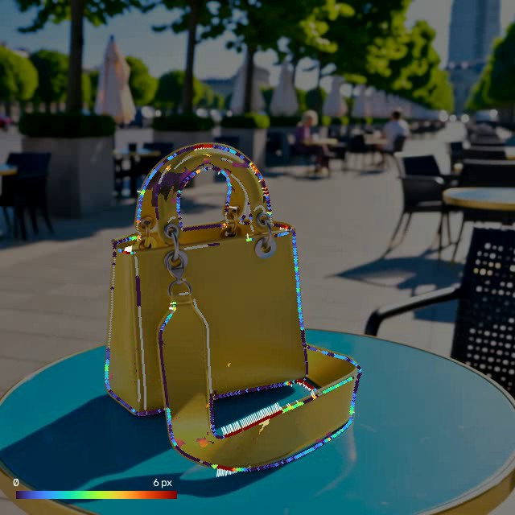

*Frame 30 of the original-mask video. The 3D contour is coloured by the offset found in the AI frame (blue = 0, red = 6 px); white lines join a 3D edge to the AI edge when they are more than 3 px apart. Circles = silhouette, squares = occlusion edges, diamonds = creases, grey = not trusted. The inside of the bag shows the secondary measurement (optical flow on corners and patterns).*

**2. Know what a number means: calibration, then the lighting trap.** Fake videos made from the renders (hue, contrast, background, noise and MP4 compression changed, geometry intact) give the noise floor. Known "bumps" of 0.5 to 4 px give the sensitivity. One finding changed the method: **light alone moves edges**. The same undeformed bag, rendered under two different suns, "moves" its rounded creases by **5 to 8 px**. So:

- `animate_drop.py --passes lights` renders 11 **basis lights** (10 suns + 1 sky) as linear 16-bit PNG. Light adds up, so any lighting is a weighted sum of these renders: thousands of relightings, without Blender.
- `comp/edge_confidence.py` derives a **per-point confidence map**: is this edge visible under most lightings (visibility)? How far does light alone move it (tolerance, p90)? Only the offset **beyond** the tolerance counts as deformation. Tolerances are learnt on 12 random lightings and tested on 4 unseen ones (cross-validation).

**3. Prevent: an exact mask for the repaint pass.** The deformation map showed that pass 2 (the colour change) made the edges worse. Inside the grey hole, VACE only knows the bag's shape from the mask contour, and the original mask was 4 px too wide. With the **exact silhouette** (`comp/pass2_masks.py --margin 0`, same pass 1, two seeds per mask):

| Reliable edge points more than 1 px beyond their tolerance (frames 10–48) | Pass 1 only | Mask +4 px | **Exact mask** |
|---|---|---|---|
| All edges | 22 % | 32–38 % | **16–18 %** |
| Handles, charm, strap | 16 % | 46–47 % | 18–19 % |
| Stitching | 7 % | 76–82 % | 3–9 % |

*(Two seeds per mask; the original +4 px mask is shown here on the controlled pass-2 re-runs.)*

**About half as many deformed edges**, and even fewer than pass 1 alone: a sharp mask contour is a **shape constraint**, not only an area to repaint.

**4. A negative result, kept:** accumulating the measurement over the 35 still frames (`comp/temporal_accumulation.py`, `comp/temporal_noise.py`) changes nothing. The AI's shape is wrong but **stable**: frame-to-frame jitter of an edge point is only 0.02–0.07 px. The limit is a systematic bias (the AI's unknown lighting), not random noise.

**5. Correcting it: tried, then abandoned** (`comp/edge_correction.py`, kept for reference). The idea was to warp the AI frame so that its edges land back on the 3D edges. A displacement field is built from the reliable silhouette and occlusion points (normalized convolution, σ = 4 px), only the offset beyond each point's lighting tolerance is corrected, and two safeguards apply: neighbour consistency and anti-fold.

**On paper it worked.** On fake videos with known bumps, under unseen lightings, a 3 px silhouette bump dropped to 1.26 px and no healthy edge was damaged. Re-measured with the same detector, the real videos looked fixed too.

**On screen it did not.** Seen at full size, the corrected frames look like a Photoshop *Liquify* brush, and that is exactly what a warp is:

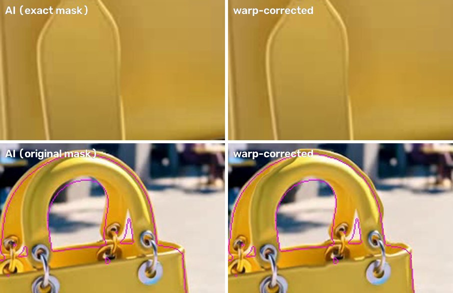

*Frame 40, 3D contour in magenta. Top: even where the AI is almost right (exact mask), the strap tab is dented where leather passes over leather. Bottom: where the AI is far off (handle drawn 5 to 10 px too thick), the correction is partial and lumpy, with a double edge.*

Why it fails:
- **A warp is a set of brush strokes.** The field only exists at edge points. Neighbours push by different amounts, or not at all (inside their tolerance, or not measurable: 24–29 % of the points). The field changes within a few pixels, and the leather's highlights bend with it.
- **The least reliable measurements sit where errors show most.** On internal edges (leather in front of leather), the lighting tolerance is about 2 px and the inside/outside colour test is meaningless. A 1 px mistake there is in the middle of the product.
- **Large deformations cannot be pushed back.** A warp moves existing pixels. It cannot redraw a handle that the AI drew 10 px too thick.
- **The re-measurement was circular.** "16 % → 4 % of edges off" only showed that the correction obeyed the detector. An independent colour-based measurement (yellow-leather mask vs 3D mask) gave a real gain of only **12 % (exact mask) and 19 % (original mask)**.

Three bugs were found and fixed on the way, and each fix exposed the next problem:
1. **The detector latched onto the cast shadow.** Its inside/outside test was only *relative*: cyan table vs navy shadow passed, because cyan is "closer" to yellow. Fixed with an absolute condition in `deformation_map.py` (the inside of an edge must look like the bag).
2. **The correction aimed at the wrong target.** The deformation map removes a global affine "placement" so that it measures shape independently of position. But the affine absorbs part of the real deformations (handles) and creates fictitious offsets on correct edges, which the warp then "fixed" into bumps. Fixed by aiming at the 3D contour itself: the video is generated from the render, so the right position is known.
3. **Internal edges.** Not fixable by tuning: see above.

**Conclusion.** Shape is **measured** after generation (`deformation_map.py`) and **prevented** before it (exact pass-2 mask: half as many deformed edges). It is not repaired with a warp. A real repair would mean re-compositing the rendered part, as in demo A, or regenerating.

**6. Knowing the light: tried, partial result** (`comp/light_estimation.py`, kept for reference). The measurement is limited by light: a rounded edge moves with the light direction, hence the per-point tolerances (≈ 0.7 px on the silhouette, ≈ 2 px on internal edges). If the AI's light were known, its effect on each edge could be predicted and subtracted.

Light adds up, so the AI's light can be searched as a **non-negative mix of the basis lights** (NNLS on the luminance of the leather, unknown tone curve). The undeformed bag is then re-rendered under that light, and its edges give the light-induced offset to subtract.

| Median tolerance (frame 30, fake videos, unseen lightings) | No light | 11 lights, true light in the basis | 11 lights, true sun removed | **38 lights** (`--dense-lights`) |
|---|---|---|---|---|
| Silhouette | 0.75 px | 0.24 px | 0.79 px | **0.70 px** |
| Internal edges | 1.99 px | 0.49 px | 1.34 px | **0.95 px** |

- **It works only when the light is exactly in the basis.** In the realistic case, the true light falls between the basis suns, and the gain collapses.
- **A denser basis recovers the light, not the edges.** With 38 lights, the luminance fit is almost ideal (4.2 % residual vs 3.6 %), yet the silhouette tolerance barely moves. Matching the light "on average" does not say where the last lit pixel of a rounded edge falls.
- **On real AI frames, material matters more than light.** The fit residual is 10–18 %, and the "light" found is a mix of 9–10 lights compensating for the AI's different contrast, highlights and hue. The AI frame stays more beautiful and coherent than the re-render, which is fine for a measuring instrument, but this instrument is not precise enough.

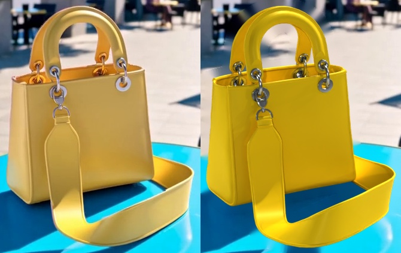

*Frame 30, exact-mask video. Left: AI. Right: the 3D bag re-rendered under the light estimated from the AI frame (38 basis lights). The light direction is plausible; the material is not the AI's.*

---

## Repository

| Path | What it does |
|---|---|
| `blender/export_passes.py` | Renders beauty (RGBA), depth, camera-space normals and **one mask per material** for each camera. Emission-material swap (robust to Blender 5's compositor changes). Options: `--passes depth_table` (invisible round table in the depth only, disparity encoding), `--sun` / `--bounce` (relight the beauty to match a generated set). |
| `blender/animate_drop.py` | Drop animation with colour switch at contact: per-frame simple render, depth (fixed range), beauty, masks (object / metal / leather). Optional passes: `normal` (creases), `ids` (one value per model part, no anti-aliasing), `lights` (11 linear basis lights; `--dense-lights`: 38). Options `--sun`, `--view Standard` for sunlit, non-desaturated reference images. |
| `blender/flatten_simple.py`, `blender/inspect_model.py` | Helpers. |
| `qa/fidelity_qa.py` | **Per-zone fidelity QA**: SSIM after light equalization, edge F1 (Canny, ±2 px), ΔE2000 with reference lightness. HTML report, heatmap, edge map. |
| `qa/make_test_case.py` | Builds a known-good and a known-bad image to self-test the QA. |
| `comp/frequency_reinjection.py` | Keeps the AI's low frequencies (light) and re-injects the render's high frequencies (texture), multiplicatively in linear light; optional chroma restore in Lab. |
| `comp/video_qa.py` | Per-frame QA + re-injection for video, with affine re-alignment (ECC) and temporal stability. |
| `comp/video_brand_color.py` | Enforces exact brand colours in a video while keeping the AI's transition timing. `--swatch`: targets from the brand swatch (`anim.json`) with chroma following the AI's lightness; `--transition-end`: the whole bag must have switched by that frame. |
| `comp/vace_api.py`, `comp/vace_two_pass.py` | Build / queue Wan 2.2 Fun VACE graphs through the ComfyUI API. |
| `comp/deformation_map.py` | **Per-frame deformation map**: silhouette, occlusion edges and creases vs the 3D render, after removing the global placement. `measure` (CSV, curves, annotated video) and `calibrate` (noise floor + sensitivity on fake videos). |
| `comp/edge_confidence.py` | Per-point **confidence map** from the basis lights: visibility and lighting tolerance of each edge point, cross-validated on unseen lightings. |
| `comp/lighting_noise_test.py` | Measures the offsets caused by lighting alone (same undeformed bag, other suns). |
| `comp/temporal_accumulation.py`, `comp/temporal_noise.py` | Temporal median over the still frames, and frame-to-frame jitter (negative result: the AI's deformation is stable). |
| `comp/edge_correction.py` | *Abandoned experiment, kept for reference.* Warps the AI video so its edges land back on the 3D edges. `validate` (known bumps, true-field error) and `correct`. See step 5 for why it was abandoned. |
| `comp/light_estimation.py` | *Partial / negative result, kept for reference.* Estimates the AI frame's light as a mix of basis lights and tests whether it shrinks the edge tolerances (`validate`, `estimate`). See step 6. |
| `comp/pass2_masks.py`, `comp/vace_pass2_mask.py` | Pass 2 temporal mask with a chosen margin, and a graph that re-runs pass 2 alone on a saved pass 1. |
| `comp/compare_measurements.py` | Side-by-side table of several deformation measurements, per model part. |
| `workflows/` | ComfyUI workflows (UI format, plus one API-format graph). |

### Models used (not included)

Flux.1 dev (fp8) · FLUX.1-dev ControlNet Union Pro 2.0 (fp8) · Qwen-Image-Edit-2511 (GGUF Q4_K_M) + Lightning 4-step LoRA · Wan 2.2 I2V 14B + lightx2v · Wan 2.2 Fun VACE 14B (fp8) + T2V lightx2v 4-step LoRAs · Wan 2.1 VAE · umt5-xxl. Tested on an RTX 5080 Laptop (16 GB VRAM), ComfyUI 0.29, Blender 5.2.

**Tip:** verify every downloaded model with its SHA-256 (`X-Linked-ETag` on Hugging Face). Three browser-downloaded files here had the right size but corrupted content; a corrupted VAE produced uniform grey images.

### Install

```bash
python -m venv .venv
.venv/Scripts/pip install -r requirements.txt     # Windows (use .venv/bin/pip elsewhere)
```
Blender scripts run inside Blender 5.x (`blender -b --factory-startup --python <script> -- <options>`).

### Quick start

```bash
# 0. Self-test the QA on a demo scene: the "ok" image must PASS, the "ko" image must FAIL
blender -b --factory-startup --python blender/export_passes.py -- --demo --out renders_demo --num-cams 1
python qa/make_test_case.py renders_demo/cam01
python qa/fidelity_qa.py --ref renders_demo/cam01_beauty.png --gen renders_demo/cam01_gen_ok.png --out reports/ok --white-balance logo
python qa/fidelity_qa.py --ref renders_demo/cam01_beauty.png --gen renders_demo/cam01_gen_ko.png --out reports/ko --white-balance logo

# 1. Passes for your own model (beauty, depth with a round table, normals, masks per material)
blender -b --factory-startup --python blender/export_passes.py -- --import model.glb --out renders         --hdri studio.hdr --passes beauty,depth,depth_table,normal,masks

# 2. In ComfyUI: workflows/01 (set), 02 (composite), 03 (harmonize)

# 3. Restore texture and colour, then measure
python comp/frequency_reinjection.py --harmonized harmonized.png --render renders/cam05_beauty.png        --sigma 4 --chroma 0.8 --out fixed.png
python qa/fidelity_qa.py --ref renders/cam05_beauty.png --gen fixed.png --out reports/fixed
```

**Video:** `blender/animate_drop.py` renders the per-frame passes; encode `depth/` and the after-contact mask as MP4 (`drop_depth.mp4`, `drop_mask_after_contact.mp4`) into ComfyUI's input folder with a yellow reference image (`drop_ref_yellow.png`); run `workflows/06_*`; then `comp/video_brand_color.py` and `comp/video_qa.py`.

**Shape (deformation map):**

```bash
# Passes needed: depth, masks, normals, part ids, basis lights
blender -b --factory-startup --python blender/animate_drop.py -- --import bag.glb --out renders/drop --hdri studio.hdr \
    --passes simple,depth,beauty,masks,normal,ids,lights

# Exact-silhouette mask for pass 2 (instead of +4 px)
python comp/pass2_masks.py --refs renders/drop --margin 0 --out <ComfyUI>/input/drop_mask_after_contact_m0.mp4

# Confidence map (an AI video provides a realistic set), then measure
python comp/edge_confidence.py --refs renders/drop --background-video ai.mp4 --out renders/confidence
python comp/deformation_map.py measure --refs renders/drop --video ai.mp4 --confidence renders/confidence --out reports/deformation
```

---

## Known limits

- **Partly circular after correction.** Re-injected texture and colour come from the render, so their scores rise partly by construction. What is proven: the raw AI output drifted, and the correction did not damage the AI's light. The tool's value is in **detection**.
- **Thresholds are starting values** (SSIM ≥ 0.80, F1 ≥ 0.75, ΔE ≤ 5; < 2 for a brand colour). They should be calibrated with a house, on its own approved and rejected references.
- **1024 px only**, one product, one material family (embroidered raffia). Not yet tested: 4K, polished metal, glass, patent leather.
- **Video is a first result**, not a finished pipeline.
- **Shape is measured, not repaired.** The warp-based correction was abandoned (see step 5). The measurement itself is limited by the lighting tolerance (≈ 0.7 px on the silhouette, ≈ 2 px on internal edges); estimating the AI's light from basis lights did not lower it enough (step 6). A slide *along* an edge is invisible to the measurement.

## Next

- Estimate the generated set's lighting and **re-render the product in Blender** with it — exact by construction, no correction needed. Step 6 shows the hard part: the AI's material differs from Blender's, so the light alone does not explain the image.
- Organic transition masks ("ink in water") driven from the impact point.
- A blind, independent evaluation (perceptual metrics, OCR of lettering, vision-language checks) to break the circularity.
- A per-zone pass/fail report an art director can sign off.

## License

Code: MIT (see `LICENSE`). Images in `docs/` are renders and AI outputs of a third-party CC-BY model, shown for documentation only.
